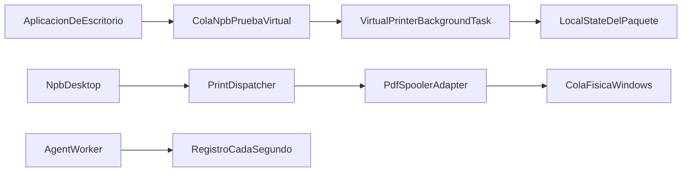

# Incremento 0 — diagnóstico

Fecha de lectura del árbol: `main` en `8b0cac7`. Este documento describe lo que el código hace hoy. Lo que no aparece en el repositorio se dice como ausencia, no como comportamiento.

## Recorrido que existe

Hay dos caminos que no se hablan.

La captura virtual termina en el disco del paquete. Una aplicación imprime en la cola `NPB - Prueba Virtual`. El spooler activa `VirtualPrinterBackgroundTask`. La tarea copia el flujo a `ApplicationData.Current.LocalFolder\Neobash\PrintBridge\Jobs\{id}\` y cierra el trabajo ante Windows con `JobCaptureStatus`. No hay envío a otra máquina ni al agente.

La impresión local de PDF termina en una cola física de este equipo. `NPB Desktop` lee un PDF ya existente, lo prepara y lo entrega con `PdfSpoolerAdapter`. El historial de esa entrega vive en otra carpeta, fuera del paquete.

`src/Agent` no participa en ninguno de los dos.

## Componentes que se pueden reutilizar

- `src/Core/Capture/JobCaptureStore.cs` copia el flujo por bloques de 81920 bytes, exige tamaño mayor que cero y escribe `metadata.json`. El nombre del archivo es `document.oxps` solo si el tipo declarado es `application/oxps`; en cualquier otro caso es `document.bin`.
- `src/Core/Capture/FileSystemJobFileStore.cs` crea un directorio nuevo por identificador. Si el directorio ya existe, falla. Rechaza un nombre con ruta (`Path.GetFileName`) y un identificador que salga de la raíz.
- `src/Core/Capture/JobIdRules.cs` rechaza vacío, más de 80 caracteres, `..`, caracteres inválidos de nombre de archivo y un primer carácter que no sea letra o dígito ASCII.
- `src/Core/Capture/VirtualPrinterJobCompletion.cs` cierra el trabajo ante Windows una sola vez. `Succeeded` solo si la captura terminó en `Succeeded`. Una cancelación gana aunque se hayan escrito bytes.
- `src/Core/Capture/VirtualPrinterPrintTicket.cs` valida en memoria `PageMediaSize` (`ISOA4`, `NorthAmericaLetter`), `PageOrientation` (`Portrait`, `Landscape`) y `PageOutputColor` (`Color`, `Monochrome`).
- `src/Core/Dispatch/PrintDispatcher.cs` rechaza lo que no es `application/pdf` antes de `TryBegin`, rechaza una cola virtual, no reenvía un identificador ya registrado y separa el fallo previo al spooler (`Failed`) del fallo cuando el envío ya empezó (`Uncertain`).
- `src/Windows/Desktop/Printing/PdfDocumentPreparer.cs` mide el PDF con `Windows.Data.Pdf` y arma un `PreparedPdf`. No convierte otros formatos.
- `src/Windows/Desktop/Printing/PdfSpoolerAdapter.cs` exige `PreparedPdf` con páginas, abre `System.Drawing.Printing.PrintDocument` en un hilo STA llamado `NPB print STA` y usa PDFium en modo EMF (`FPDF_PRINTMODE_EMF`).
- `src/Core/Dispatch/PageLayoutCalculator.cs` no inventa un DPI, no combina el porcentaje con otro ajuste, pide confirmación explícita para el recorte y rechaza un raster de más de 48 000 000 píxeles sin sustituirlo por una imagen más pequeña.
- `src/Core/Dispatch/JobRecovery.cs` pasa a `Uncertain` solo `Received` y `Prepared`, con el texto «No se reimprime.» No llama al spooler.
- `src/Core/Dispatch/FileJobRecordStore.cs` guarda la fase y, aparte, `PhysicalConfirmation`.
- `src/Windows/Desktop/App.xaml.cs` activa la ventana antes de `BeginStartup`. La recuperación y el catálogo van después. El tema claro está en `src/Windows/Desktop/Themes/Light.xaml`: lienzo `#EDEDF6`, índigo `#3D4BFF`.

Esas piezas se conservan. El Incremento 1 no las reemplaza para «aprovechar» la red.

## Lo que no está listo

### El agente es una plantilla

`src/Agent/Program.cs` solo registra `Worker`. `src/Agent/Worker.cs` escribe «Worker running at» cada segundo hasta la cancelación. No referencia tipos de `Core`, no abre un puerto, no lee trabajos y no llama al spooler. El proyecto sí referencia `Core` (`src/Agent/Neobash.PrintBridge.Agent.csproj`, `net10.0`, SDK Worker) y no usa esa referencia. `appsettings.json` solo ajusta el nivel de registro.

No hay `UseWindowsService`, ni otro host, ni un proceso de sesión distinto del genérico de `Microsoft.Extensions.Hosting`.

### Conexiones y Accesos no operan

`ConnectionsPage.Activate` y `AccessPage.Activate` están vacíos. El XAML de Conexiones muestra textos fijos: el equipo local «está presente»; red local, integraciones, GELIA-NV y conexión remota dicen «No disponible». Accesos dice que no concede permisos, no invita y no simula una sesión, y muestra «Ningún equipo vinculado.» No hay botones de emparejamiento ni de red.

`DesktopNavigation` sí acepta las secciones `connections` y `access`. Llegar a la página no ejecuta un flujo.

### Dos historiales, sin puente

| Historial | Dónde lo escribe el código | Qué estado guarda |
| --- | --- | --- |
| Captura de la tarea | `ApplicationData.Current.LocalFolder\Neobash\PrintBridge\Jobs\{id}\` (`VirtualPrinterBackgroundTask`) | `metadata.json`: `Succeeded`, `Failed` o `Canceled`. Documento opaco. |
| Despacho de Desktop | `%LOCALAPPDATA%\Neobash\PrintBridge\Desktop\jobs\{id}.json` (`App.xaml.cs` + `FileJobRecordStore`) | `JobPhase`, detalle y, si corresponde, confirmación física. |

Desktop no está empaquetado (`WindowsPackageType` es `None` en `src/Windows/Desktop/Neobash.PrintBridge.Desktop.csproj`). Su carpeta es la de la cuenta de Windows, no el `LocalState` del paquete. La tarea empaquetada usa `ApplicationData.Current.LocalFolder`. El repositorio no contiene una lectura de una carpeta de paquete desde Desktop ni desde el agente. `PackageIdentityTests` solo comprueba que el texto `LocalState` no aparece en el csproj de Core; eso no es una prueba de ACL ni de lectura cruzada.

Tampoco hay un identificador compartido: la captura genera hora UTC más GUID (`TimeGuidJobIdGenerator`); el despacho usa el `Id` que le pasa quien llama.

En la misma raíz de Desktop conviven `destinations.json` y `preferences.json`, cada uno con su propio `Lock` de instancia y su par escritura temporal + `File.Move`.

### Deduplicación actual

`FileJobRecordStore.TryBegin` es la deduplicación que hay. Bajo el `Lock` de esa instancia, si `{id}.json` ya existe devuelve falso y no compara ruta, tipo, destino ni cola. La prueba `Job_intent_survives_a_new_store_and_blocks_a_second_begin` vuelve a llamar `TryBegin` con la cola «Otra impresora» y el archivo sigue diciendo `Star BSC10`.

`PrintDispatcher`, si `TryBegin` falla, devuelve la fase ya guardada y el texto «El identificador ya fue registrado y no se envía de nuevo.» No distingue una repetición idéntica de un contenido o un destino distinto. No existe una clave de dispositivo más identificador de origen.

El `Lock` es `System.Threading.Lock`, creado por instancia (`new Lock()`). No es un mutex con nombre ni un bloqueo de archivo entre procesos. Dos instancias en el mismo proceso no comparten el candado: `History_cache_rebuilds_from_json_written_by_another_store` escribe desde la segunda mientras la primera conserva una lista en caché antigua. `Find` relee el disco; `List` no, hasta `RebuildFromDisk`.

La escritura de un registro es `WriteAllText` a `{id}.json.tmp` y después `File.Move` con sobrescritura. `List` solo enumera `*.json`. La prueba `Unreadable_history_file_does_not_hide_the_rest_or_a_temporary_file` deja un `.tmp` y un JSON roto: el temporal no sustituye al registro sano y el roto produce un aviso, no un trabajo. No hay una prueba que mate el proceso entre el temporal y el `Move`. No hay transacción que cubra el archivo del documento y el JSON a la vez.

### OpenXPS, ticket y papel

`OpenXpsLimits.StructuralValidationAvailable` es `false`. `JobCaptureResult.OpenXpsStructureValidated` también devuelve `false`. `OpenXpsBoundaryTests` guarda bytes que empiezan por la firma ZIP `PK` y comprueba que `metadata.json` no afirma validez OpenXPS. El formato guardado es el tipo que declaró Windows.

`PrintSupportExtensionBackgroundTask` lee el XML del ticket, llama a `IsValid` y registra «PrintTicket resuelto.» o «PrintTicket no válido.» No escribe el XML en disco. El PDC `src/Windows/VirtualPrinter/Config/NpbPruebaVirtual.pdc.xml` anuncia A4 (210000 × 297000 µm) y carta (215900 × 279400 µm), orientación y color. No anuncia 80 mm ni un paso RAW.

`PdfSpoolerAdapter` busca el nombre de papel en `PrinterSettings.PaperSizes` de esa cola. Si no está, falla antes de `Print` (`Started` falso). Eso no dice que todos los controladores acepten A4, carta u OXPS. El repositorio no contiene una matriz de controladores.

Las pruebas de opciones usan nombres como `80mm x Receipt (48 Columns)` cuando el catálogo simulado los incluye. Eso no está en el PDC de la cola virtual.

### Manifiesto

`src/Windows/VirtualPrinter/Package.appxmanifest`:

- una sola `PrintSupportVirtualPrinter`, URI `neobash-print-bridge:npb-prueba-virtual`, formato preferido `application/oxps`, sin `OutputFileTypes`;
- `TargetDeviceFamily` `Windows.Desktop`, `MinVersion` y `MaxVersionTested` `10.0.26100.0`;
- única capacidad: `runFullTrust`.

No aparece `broadFileSystemAccess` ni `internetClient` (`PackageIdentityTests`). El mismo `MinVersion` está en los csproj de VirtualPrinter y de Desktop. `README.md` pide Windows 11 24H2, compilación 26100. Windows 10 no es un requisito de este árbol. Una etiqueta de registro `ProductName` que diga «Windows 10 Pro» en un equipo 11, anotada en `docs/A1.4-rendimiento.md`, no convierte a Windows 10 en plataforma soportada.

## Dependencias que sí están

- .NET 10. Core es `net10.0`. Desktop y la impresora virtual son `net10.0-windows10.0.26100.0`, x64.
- Windows App SDK y CsWinRT en los proyectos de ventana y de paquete. El componente WinRT de la tarea no es autocontenido; lo describe `docs/architecture.md`.
- `System.Drawing.Common` 10.0.0 y `bblanchon.PDFium.Win32` en Desktop, para el envío GDI del PDF.
- El paquete MSIX firmado para sideload, identidad `Neobash.PrintBridge.VirtualPrinter`, publicador `CN=Neobash Print Bridge POC`, versión `1.0.1.0`.

## Dependencias que no están

No hay SQLite, `HttpListener`, Kestrel, TLS, certificados de transporte, Credential Manager, DPAPI, tuberías con nombre, `GetNamedPipeClientProcessId`, identidad de paquete del cliente IPC ni `IPrintDocumentPackageTarget`. Una búsqueda en `src` no encuentra esos nombres. Diseñarlos aquí no significa que el binario ya los haga.

Tampoco hay regla de firewall, token de dispositivo ni trabajo anónimo: no hay receptor de red que pudiera aceptarlos.

## Deuda que condiciona los contratos

- El agente no es un servicio de impresión. Habrá que sustituir el bucle de la plantilla, no envolverlo.
- La red no puede reutilizar el JSON de Desktop como cola entre procesos. El candado no sale del proceso y `TryBegin` no conoce dispositivo, contenido ni destino.
- Un OXPS capturado no es un PDF preparado. `PrintDispatcher` lo rechazaría con «Esta entrega solo prepara application/pdf.» y no dejaría registro, porque el rechazo ocurre antes de `TryBegin`.
- La calidad del PDF en papel sigue abierta. `docs/roadmap.md` recuerda que la primera salida se vio pixelada y que el raster nuevo no queda aceptado hasta compararlo con el navegador al 90 %, en el mismo papel y la misma impresora. `PdfiumPrintSession` evita aplanar cada página a un mapa de bits de pantalla; PDFium aún puede rasterizar efectos puntuales. Ese camino no es un conversor OXPS→PDF.
- El spooler no es papel. `HomeBanner` lo dice en los dos subtítulos. La página de trabajos solo habilita la confirmación física en `SubmittedToSpooler` y añade «resultado incierto, sin reimpresión» cuando la fase es `Uncertain`.
- GELIA-NV está fuera. La página de Conexiones y `docs/roadmap.md` lo tratan como integración futura, no como dependencia.
- No hay alta dinámica de colas virtuales. El manifiesto declara una. `docs/architecture.md` explica por qué no se usa `Windows.Devices.Printers.VirtualPrinter`.

## Garantías de A1.4 y A1.5 que siguen vigentes

- La ventana queda activa antes de enumerar colas y antes de marcar interrumpidos (`App.xaml.cs`, `DesktopSession.BeginStartup`).
- Un identificador ya registrado no se envía otra vez.
- `Uncertain` no dispara una reimpresión. La recuperación solo cambia la fase y el detalle.
- El PDF se coloca con el tamaño físico y el DPI que informa la cola. Sin DPI genérico, sin segundo ajuste automático, sin saltarse el tope de memoria del raster.
- La interfaz permanece en claro, lavanda e índigo, aunque `preferences.json` pueda guardar otro valor de apariencia todavía sin diccionario (`docs/A1.5-experiencia.md`).
- «Destino configurado» exige capacidades leídas y no afirma papel.
- Los estados que se muestran salen del registro, no de un indicador fijo.
