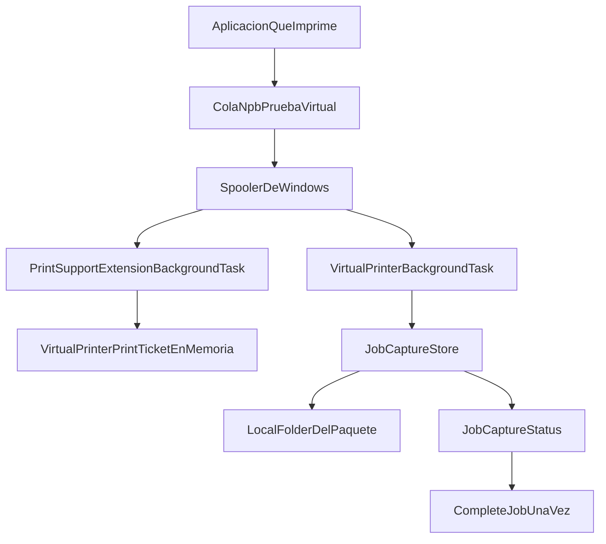
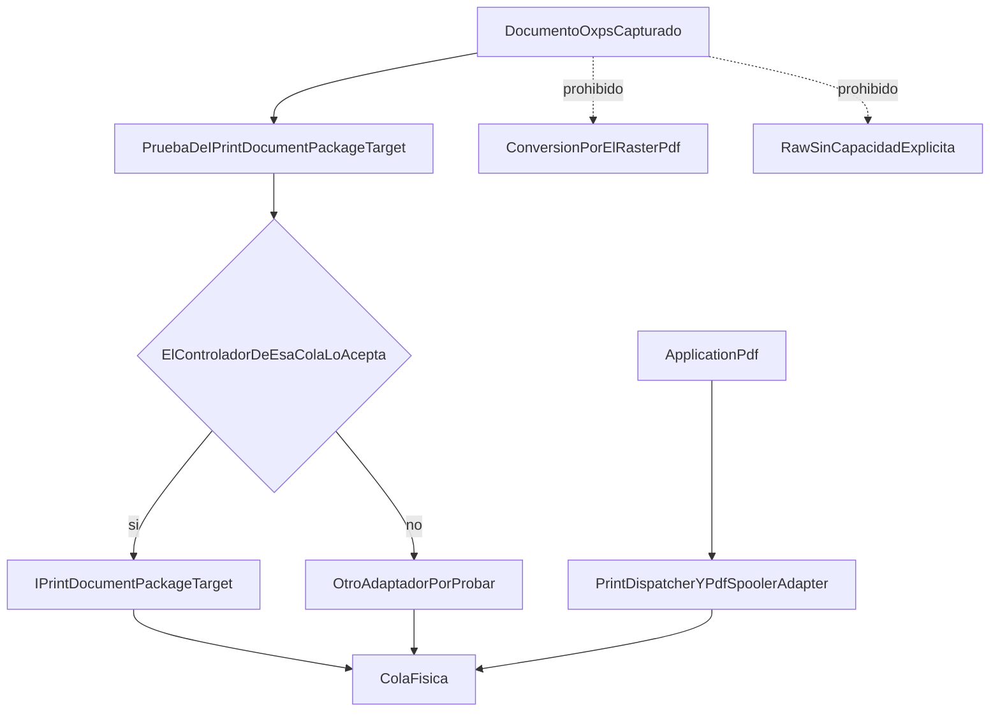
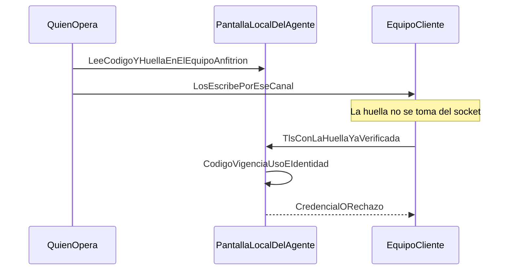
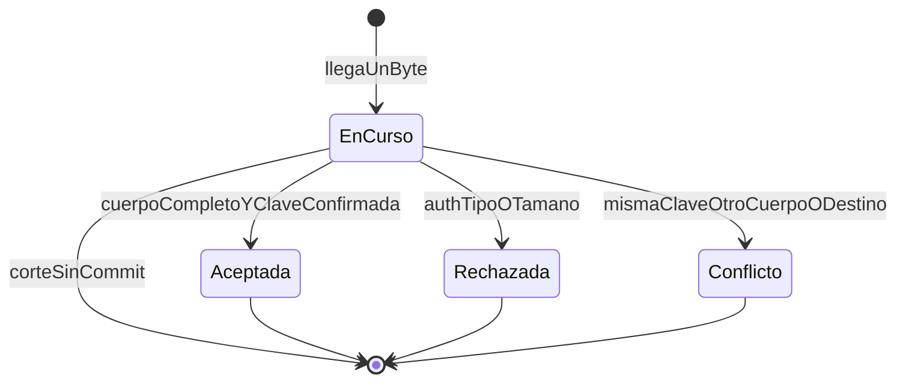
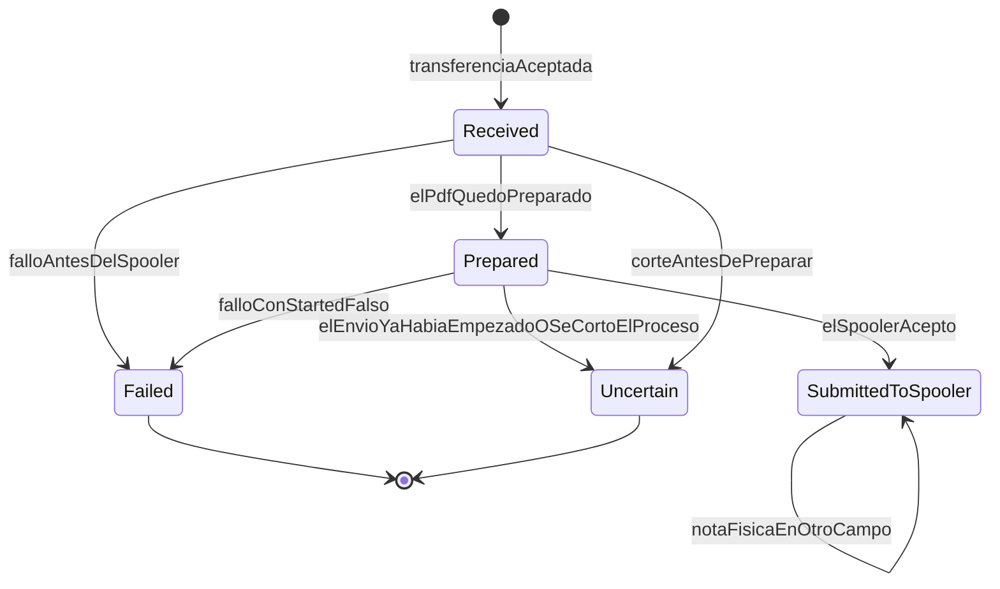
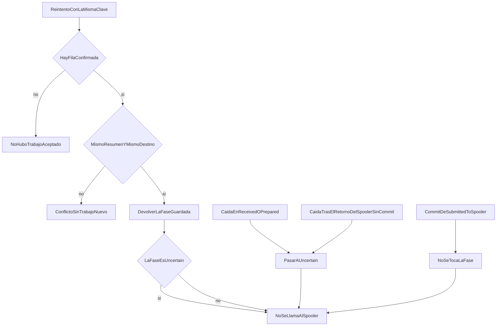
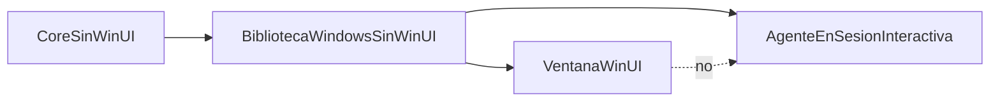

# Incremento 0 — arquitectura A2 / B1

Contrato del recorrido. No describe código de red ya escrito: el receptor LAN, la tubería, el almacén SQLite y el adaptador OpenXPS no están en el repositorio. Los tramos marcados como existentes citan archivos. Los demás son la forma que los incrementos posteriores tienen que respetar.

El recorrido completo, cuando B2 exista, es:

PC cliente → impresora virtual NPB → transporte LAN autenticado → NPB Agent → destino físico → controlador Windows.

El MVP ata una sola cola virtual a un solo destino remoto. No hay alta dinámica de colas. GELIA-NV queda fuera. Windows 10 queda como posibilidad futura, no como requisito: el manifiesto fija `MinVersion` `10.0.26100.0`.

## Qué cubre cada incremento

- 0. Estos contratos.
- 1. PDF por la LAN, con el motor PDF que ya existe, autenticación, autorización por destino, TLS comprobado y almacén nuevo del agente.
- 2. OpenXPS en el equipo local, después de las pruebas de concepto de `IPrintDocumentPackageTarget` y de la tubería.
- 3. La cola virtual del equipo cliente pasa a usar el transporte del Incremento 1.
- 4. UI de emparejamiento, historial en Desktop y migración de los JSON históricos de Desktop.
- 5. Endurecimiento y prueba física con dos equipos. El papel se mira. Aceptar el spooler no es papel. Completar la red no es aceptar el spooler.

## Captura local que ya existe

Hechos de código:

- La extensión valida el ticket y no lo guarda (`PrintSupportExtensionBackgroundTask`).
- La tarea solo escribe bajo `ApplicationData.Current.LocalFolder` (`VirtualPrinterBackgroundTask`). El manifiesto no declara `broadFileSystemAccess`.
- El cierre hacia Windows es `Succeeded`, `Failed` o `Canceled`. Es independiente de `JobPhase` y de cualquier estado de red, que todavía no existe.
- `OpenXpsLimits.StructuralValidationAvailable` es falso. El archivo guardado no demuestra un OpenXPS válido.

Esa captura sigue siendo el origen del documento en el equipo cliente. El Incremento 1 no la convierte en receptor LAN. El Incremento 3 es el que la conecta al transporte.

## Procesamiento OpenXPS, todavía sin implementar

Decisiones ya cerradas, no un borrador:

- La primera alternativa de envío OXPS es `IPrintDocumentPackageTarget`. El repositorio no la referencia. Si la prueba de concepto muestra una incompatibilidad real con el controlador de esa cola, se prueba otro adaptador. No se cierra la puerta de antemano y no se afirma que todos los controladores sirvan.
- No se modifica el motor PDF. `PrintDispatcher` rechaza lo que no es `application/pdf`. `PdfSpoolerAdapter` exige `PreparedPdf` y usa `PrintDocument` GDI.
- No hay conversión OXPS→PDF por el raster de A1.5. La calidad de ese raster en papel no está cerrada (`docs/roadmap.md`, `docs/A1-prueba-fisica.md`).
- No hay envío RAW de OXPS si la cola no anuncia esa capacidad. El PDC actual no anuncia paso directo ni 80 mm.
- El ancho de papel tiene que existir antes de paginar. No se recorta un A4 para simular un ticket. Primero papel de hojas (A4 y carta, que son los que el PDC y el ticket ya conocen). Star BSC10 y POS80 quedan después, y solo con un nombre de papel que esa cola física anuncie: `PdfSpoolerAdapter` ya falla si el nombre no está en `PaperSizes`.

La tubería local que alimentaría al agente desde la tarea también espera su prueba de concepto. Hasta entonces el OXPS sigue en la carpeta del paquete y no se lee desde otro proceso: el repositorio no demuestra esa lectura.

## Transporte LAN

En el MVP hay una cola virtual y un destino remoto vinculado. La vinculación es un permiso guardado, no un alta de colas en Windows. El manifiesto sigue con una sola `PrintSupportVirtualPrinter`.

El Incremento 1 puede probar el receptor con un PDF ya existente, sin esperar a la cola virtual. El contrato del mensaje es el mismo que usará el Incremento 3: dispositivo, identificador de origen, identificador de un destino ya publicado, tipo `application/pdf` y cuerpo completo. El mensaje no lleva un nombre de cola de Windows. Un OXPS no entra por ese receptor.

El destino que el cliente puede elegir sale de SQLite del agente. `destinations.json` de Desktop no se lee ni se escribe en ese camino.

El agente escucha en la red local del equipo anfitrión. No se publica en Internet. Este incremento no crea la regla de firewall; el documento de seguridad dice cuál tendría que aplicar quien opera el equipo, más adelante y a mano.

## Autenticación

No hay emparejamiento en el código actual. La página de Accesos lo dice. La UI llega en el Incremento 4. Los controles no esperan a esa UI: el Incremento 1 ya autentica, autoriza el destino publicado y valida TLS de verdad. Sin credencial no hay trabajo. Sin un destino publicado y concedido no hay trabajo. Una huella que solo anuncia el servidor, antes de estar autenticado, no se guarda. Un callback que acepte cualquier error TLS no cumple este contrato.

El detalle de certificado, almacén de secretos, revocación y renovación está en `04-seguridad.md`.

## Gestión del trabajo

Tres máquinas distintas. No se funden en `JobPhase`.

`EnCurso` no es un trabajo aceptado. Si el proceso cae antes del commit, no queda clave ni fila de trabajo. `Aceptada` es la única transferencia que puede crear un `JobPhase`.

`JobPhase` sigue siendo el enum de `src/Core/Dispatch/JobPhase.cs`: `Received`, `Prepared`, `SubmittedToSpooler`, `Failed`, `Uncertain`. La confirmación física no es un valor de ese enum. `FileJobRecordStore.RecordPhysicalConfirmation` solo escribe el campo cuando la fase ya es `SubmittedToSpooler`, y la prueba `Physical_confirmation_is_stored_without_changing_the_spooler_phase` comprueba que la fase no cambia.

El despacho del agente espera al commit. El orden fijo es: archivo temporal, validación, publicación del archivo, commit SQLite y solo entonces `PrintDispatcher`. Una segunda petición con la misma clave no abre otro despacho. El detalle está en `05-datos-y-estados.md`.

`JobCaptureStatus` (`Succeeded`, `Failed`, `Canceled`) solo cierra la tarea ante Windows. Una captura `Succeeded` no significa `SubmittedToSpooler` ni papel.

El motor PDF existente se invoca después de `Aceptada` y solo con `application/pdf`. Las reglas de A1.4 y A1.5 del despacho local no se relajan: deduplicación, `Uncertain` sin reimpresión, raster con tope, recorte solo con confirmación de ese trabajo, y textos que no fingen papel.

## Recuperación

Esto extiende lo que `JobRecovery` ya hace en Desktop, no lo contradice.

- `JobRecovery.MarkInterruptedAsUncertain` solo cambia `Received` y `Prepared`. El detalle fijo es «El proceso se interrumpió antes de conocer el resultado. No se reimprime.»
- No modifica `SubmittedToSpooler` ni `Failed`. La prueba `Recovery_snapshot_leaves_a_later_job_received` muestra además que un trabajo nacido después de la instantánea no se arrastra a `Uncertain`.
- Después de `Uncertain`, `TryBegin` del mismo identificador devuelve falso (`PrintDispatchTests`). No hay segundo envío.
- Si `Print()` ya empezó y salta una excepción, `PdfSpoolerAdapter` marca `Started` verdadero y `PrintDispatcher` guarda `Uncertain`. Si el proceso muere dentro de `Print()` antes del `Update`, el último JSON sigue en `Prepared` y el arranque siguiente lo pasa a `Uncertain`. En los dos casos no se reimprime. El spooler puede haber aceptado páginas: por eso el estado es incierto y no se «arregla» con otro `Print`.
- Una respuesta de red perdida, con la misma clave, el mismo resumen del cuerpo y el mismo destino, devuelve la fila ya confirmada. No crea otra y no llama al spooler. Si la fila está en `Uncertain`, la respuesta dice `Uncertain`.
- La misma clave con otro cuerpo o otro destino es conflicto. No es el `DuplicateDetail` actual, que hoy trata cualquier identificador repetido como «no se envía de nuevo» sin mirar el contenido.

`Uncertain` no tiene transición de salida hacia el spooler. Ni en el código actual ni en este contrato.

## Dónde vive cada proceso

| Pieza | Hoy | Contrato del MVP |
| --- | --- | --- |
| Ventana WinUI | `src/Windows/Desktop`, proceso aparte, no empaquetado | Sigue siendo la ventana. No hospeda el receptor. |
| Motor PDF | Tres tipos dentro de ese proyecto WinUI | Biblioteca Windows compartida, sin WinUI, usada por la ventana y por el agente. |
| Tarea de la cola virtual | Dentro del paquete, al imprimir | Sigue cerrando el trabajo ante Windows. No se convierte en el agente. |
| Agente | Plantilla en `src/Agent`, solo referencia Core | Proceso distinto, en la sesión interactiva, con la biblioteca y sin referenciar la ventana. |
| Destinos LAN | No existen. Desktop guarda los suyos en `destinations.json` | SQLite del agente. El JSON de Desktop no se comparte. |
| Servicio de Windows | No existe en el repositorio | Alternativa futura, sujeta a prueba. No se declara imposible. |

## Biblioteca compartida del motor PDF

No existe todavía. El Incremento 1 la crea y no cambia el comportamiento de los tres tipos.

La biblioteca recibe, sin modificar su lógica, `PdfDocumentPreparer`, `PdfiumPrintSession` y `PdfSpoolerAdapter`. Para que el agente pueda ejecutar el mismo `PrintDispatcher`, también recibe la sonda de colas `WindowsPrinterProbe` y el `StaQueue` que esa sonda ya usa. La vista previa (`PdfPagePreview`, `PreviewPaperReader`) y el XAML se quedan en Desktop.

`PrintDispatcher` y `PageLayoutCalculator` no se mueven: ya están en Core. El agente no referencia el csproj de Desktop ni activa `UseWinUI`. El csproj del agente, hoy `net10.0`, pasa al mismo moniker de Windows que la biblioteca (`net10.0-windows10.0.26100.0`, x64) porque PDFium, GDI y `Windows.Data.Pdf` no caben en el moniker actual. Eso no añade el SDK de WinUI.

Cómo se comprueba, dentro del Incremento 1:

- Compilación: se construyen la biblioteca, el agente y Desktop para `win-x64`. El agente no referencia Desktop. Ni el agente ni la biblioteca contienen `UseWinUI` ni `Microsoft.WindowsAppSDK`.
- Dependencias: la biblioteca queda con `System.Drawing.Common` 10.0.0 y `bblanchon.PDFium.Win32` 157.0.8100, las mismas versiones del csproj de Desktop. Core sigue sin WinUI. Las licencias de `docs/third-party/pdfium` se copian también junto al ejecutable del agente; hoy ese `Content` está solo en el csproj de Desktop. El repositorio no tiene un proyecto sin WinUI que ya compile `Windows.Data.Pdf`: la compilación de la biblioteca es la prueba de que `PdfDocumentPreparer` no necesita el paquete de la ventana. Si hiciera falta el mismo puente CsWinRT que Desktop ya usa para el SDK de Windows, se anota y se limita a eso. No se responde añadiendo `UseWinUI`.
- Ejecución desde el agente interactivo: un proceso del agente, no la ventana, construye el preparador y el adaptador compartidos y recorre `PrintDispatcher` contra un sustituto del spooler. El hilo sigue llamándose `NPB print STA`. `tests/WindowsPrintTests` pasa a referenciar la biblioteca en lugar de compilar el archivo suelto de Desktop, y sigue sin abrir WinUI. Las pruebas de Core del despacho no cambian de resultado.

`PdfSpoolerAdapter` crea un hilo STA y usa `System.Drawing.Printing`. Eso obliga a comprobar el entorno donde se llame. No es, por sí solo, una prohibición permanente de la sesión 0: este repositorio nunca ejecuta el adaptador como servicio, así que tampoco demuestra que la sesión 0 falle o funcione.

## Qué queda fuera de esta forma

- Más de una cola virtual, o crear colas en caliente.
- GELIA-NV y la conexión saliente entre redes de la letra D de `docs/roadmap.md`.
- Windows 10 como objetivo de compilación o de prueba.
- Anunciar 80 mm en el PDC, recortar A4, o tratar Star BSC10 / POS80 como destino del primer tramo.
- Leer el `LocalState` del paquete desde el agente como si el repositorio ya lo hubiera demostrado.
- Tokens en el código, trabajos sin identidad, TLS sin validación, agente expuesto a Internet.
